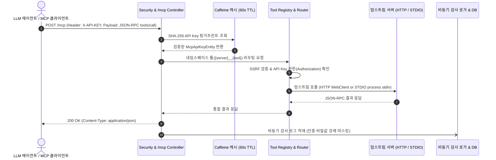
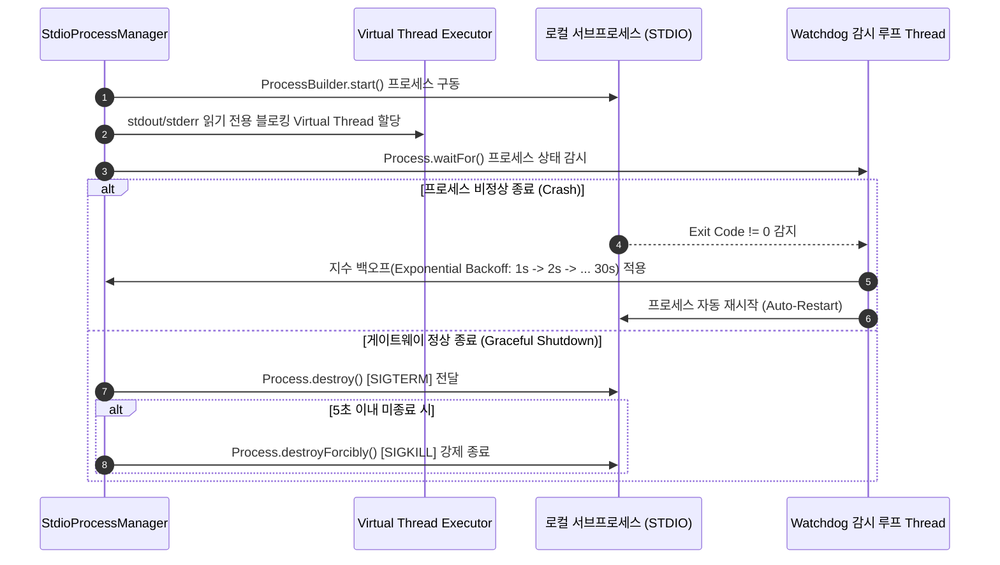

# Aggregated Hybrid MCP Proxy Gateway System (통합 하이브리드 MCP 프록시 게이트웨이 시스템)

[](https://openjdk.org/projects/jdk/21/)
[](https://spring.io/projects/spring-boot)
[](https://www.postgresql.org/)
[]()

본 프로젝트는 **Java 21 Virtual Threads**, **Spring Boot 3.3.4 (WebFlux)**, **R2DBC**, **PostgreSQL**, **Caffeine Local Cache**, **Resilience4j** 기술 스택을 활용하여 로컬 STDIO 기반 MCP 서버와 원격 HTTP 기반 MCP 서버를 단일 **Streamable HTTP 표준 엔드포인트(`/mcp`)**로 통합 관리하는 **Aggregated Hybrid MCP Proxy Gateway System**입니다.

---

## 📌 1. 프로젝트 개요 (Project Overview)

### 배경 및 목적

LLM 에이전트 및 AI 클라이언트가 다양한 외부 리소스 및 툴(Tool)을 호출하기 위해 **Model Context Protocol (MCP)** 프로토콜이 광범위하게 활용되고 있습니다. 그러나 개별 MCP 서버가 **로컬 프로토콜(STDIO)** 및 **원격 프로토콜(HTTP/SSE)**로 파편화되어 있고, 여러 서버 간 동일한 툴 이름이 충돌하는 문제, 그리고 엔터프라이즈 환경에서의 보안 인증, 서킷 브레이커, 감사 로깅의 부재가 존재합니다.

**Aggregated Hybrid MCP Proxy Gateway System**은 다음과 같은 핵심 문제를 해결합니다:

1. **단일 접점 제공**: 클라이언트(LLM 에이전트)는 오직 하나의 `/mcp` Streamable HTTP 엔드포인트만 바라보고 모든 MCP 툴에 접근할 수 있습니다.
2. **도구 네임스페이스 라우팅**: `{server_name}__{tool_name}` 규칙을 통해 서로 다른 MCP 서버 간의 도구 명칭 충돌(Naming Collision)을 원천 차단합니다.
3. **STDIO / HTTP 하이브리드 지원**: 로컬 프로세스 실행 방식(STDIO)과 원격 HTTP 방식을 투명하게 래핑 및 라우팅합니다.
4. **인프라 최소화 & 자가 치유(Self-healing)**: Redis 등 외부 분산 캐시 인프라 의존성을 완전히 배제하고, 짧은 TTL(30초~60s)과 힙 압박 예방용 bounded size(`maximumSize(2000)`)를 적용한 **Caffeine 로컬 인메모리 캐시**로 고성능 자가 치유 구조를 보장합니다.
5. **엔터프라이즈 보안 & Observability**: API Key 인증, SSRF 방어, 동적 PII 마스킹, 필수 인증 비밀값 강제 마스킹, 비동기 감사 로그, 웹 관리 대시보드를 제공합니다.

---

## 🔑 2. 기본 인증 정보 및 마스터 키 (Default Credentials)

초기 데이터베이스 구동 시 Flyway 시드 마이그레이션 스크립트를 통해 자동으로 생성되는 기본 계정 정보입니다:

| 구분                       | 아이디 / 식별자      | 기본 비밀번호 / API Key 원문  | 저장 및 보안 처리 방식            |
| :------------------------- | :------------------- | :---------------------------- | :-------------------------------- |
| **관리자 대시보드 로그인** | `admin`              | `admin1`                      | BCrypt 암호화 해시 (`$2a$10$...`) |
| **마스터 Gateway API Key** | `Master Gateway Key` | `mcp-gateway-master-key-2026` | SHA-256 핑거프린트 해시 보관      |

> [!IMPORTANT]
> 운영 환경(Production)으로 배포하기 전, 반드시 기본 관리자 비밀번호를 변경하고 초기 마스터 API 키를 재발급/폐기하십시오.

---

## 📐 3. 시스템 아키텍처 및 Mermaid 시퀀스 다이어그램

### 3.1 Streamable HTTP 엔드포인트 도구 호출 전체 흐름



### 3.2 STDIO Process Manager Watchdog & Virtual Thread 흐름



---

## ⚡ 4. 핵심 기능 및 기술적 특징 (Key Features)

### 1. Streamable HTTP 전송 규격 고정 (`/mcp`)

- 표준 MCP **2024-11-05** 명세를 엄격히 준수합니다.
- 단일 경로 `/mcp`에서 POST(JSON-RPC 2.0 처리), GET(SSE 수신), DELETE(세션 종료)를 명확히 처리합니다.

### 2. Java 21 Virtual Threads 기반 I/O 격리

- STDIO 기반 MCP 프로세스의 `stdin` 쓰기, `stdout`/`stderr` 읽기, `Process.waitFor()` 등 블로킹 I/O 작업은 Reactor 이벤트 루프를 방해하지 않도록 **전용 Virtual Thread Executor**로 완전 격리되어 동작합니다.

### 3. Resilience4j 기반 업스트림 장애 격리

- 업스트림 서버별로 **Circuit Breaker** 및 **Read/Write Timeout**을 격리 적용하여 특정 업스트림 서버 장애가 게이트웨이 전체로 전파되는 것을 차단합니다.

### 4. SSRF (Server-Side Request Forgery) 원천 차단

- remote HTTP 업스트림 서버 등록 및 호출 시, 목적지 URL의 Scheme, Host, IP 주소를 검증합니다.
- AWS/GCP 인스턴스 메타데이터 서비스(IMDS `169.254.169.254`) 및 루프백/사설 IP 대역 접근을 엄격히 통제합니다.

### 5. 운영 보안 & 동적 PII 마스킹

- **X-API-KEY 인증**: API 키 원문은 절대 DB에 저장되지 않으며 **SHA-256 해시 핑거프린트**로 검증 및 Caffeine 캐싱됩니다.
- **세분화된 도구 권한**: API 키별로 접근 가능한 업스트림 서버 및 도구 목록(`allowed_tools_json`)을 인가합니다.
- **동적 PII 마스킹 & 강제 비밀값 마스킹**:
    - 관리자 설정 토글(`pii_masking_enabled`)에 따라 감사 로그 내 이메일, 전화번호를 동적으로 마스킹합니다.
    - **[보안 제약]** API 키, 비밀번호, 토큰, Authorization 헤더 등 '인증 비밀값'은 PII 마스킹 토글 상태와 상관없이 **전역 로그에서 무조건 영구 마스킹(`[REDACTED_SECRET]`)** 처리합니다.

### 6. Graceful Shutdown (Drain Timeout 35초)

- Netty 및 Spring Lifecycle 셧다운 타임아웃을 35초로 설정하여 배포/스케일인 시 LLM 에이전트의 긴 툴 실행 호흡(In-flight Request)을 안전하게 완수하고 종료됩니다.

---

## 🛠️ 5. 기술 스택 (Tech Stack)

| 분류                       | 기술 명칭                 | 사용 목적 및 비고                                                 |
| :------------------------- | :------------------------ | :---------------------------------------------------------------- |
| **Language / Runtime**     | Java 21                   | Virtual Threads (경량 스레드) 기반 블로킹 I/O 격리                |
| **Framework**              | Spring Boot 3.3.4         | Spring WebFlux, Spring Security Reactive                          |
| **Database & Persistence** | PostgreSQL 16 + R2DBC     | 비동기 리액티브 DB 연동 (`Persistable<UUID>` 전용 PK)             |
| **Schema Migration**       | Flyway                    | Flyway JDBC 연동 (모든 테이블/컬럼 코멘트 명시적 자동 생성)       |
| **In-Memory Cache**        | Caffeine Cache            | Redis 배제, 30s~60s short TTL & `maximumSize(2000)` 자가치유 캐시 |
| **Resilience**             | Resilience4j              | Reactor Circuit Breaker 및 타임아웃 격리                          |
| **Frontend**               | Vanilla HTML5 / CSS3 / JS | CDN/NPM 의존성 없는 단일 파일 대시보드 (`dashboard.html`)         |

---

## 🚀 6. 빠른 시작 및 실행 방법 (Quickstart)

### 1) 시스템 요구사항

- Java 21 JDK 이상
- Apache Maven 3.9+
- Docker & Docker Compose (PostgreSQL 16 전용)

### 2) PostgreSQL 컨테이너 실행

```bash
docker compose up -d
```

컨테이너 헬스체크 상태 확인:

```bash
docker compose ps
```

### 3) 단위 및 통합 테스트 검증

```bash
mvn clean test
```

### 4) 게이트웨이 애플리케이션 구동

```bash
mvn spring-boot:run
```

애플리케이션 구동 후 대시보드 주소: `http://localhost:8080/dashboard.html`

---

## 🌐 7. API 명세 및 사용 예시 (API Reference)

### 1) MCP Streamable HTTP 엔드포인트 (`/mcp`)

#### 툴 목록 조회 (`tools/list`)

```bash
curl -X POST http://localhost:8080/mcp \
  -H "X-API-KEY: mcp-gateway-master-key-2026" \
  -H "Content-Type: application/json" \
  -d '{
    "jsonrpc": "2.0",
    "id": 1,
    "method": "tools/list",
    "params": {}
  }'
```

#### 네임스페이스 도구 실행 (`tools/call`)

```bash
curl -X POST http://localhost:8080/mcp \
  -H "X-API-KEY: mcp-gateway-master-key-2026" \
  -H "Content-Type: application/json" \
  -d '{
    "jsonrpc": "2.0",
    "id": 2,
    "method": "tools/call",
    "params": {
      "name": "github__create_issue",
      "arguments": {
        "title": "Bug report",
        "body": "Issue details"
      }
    }
  }'
```

### 2) 관리자 대시보드 REST API 명세 (`/api/admin/**`)

| 엔드포인트              | 메서드                    | 인증 방식     | 주요 기능                                        |
| :---------------------- | :------------------------ | :------------ | :----------------------------------------------- |
| `/api/admin/login`      | POST                      | Public        | 관리자 로그인을 통한 세션 쿠키 발급              |
| `/api/admin/logout`     | POST                      | Admin Session | 세션 무효화 및 로그아웃                          |
| `/api/admin/servers`    | GET / POST / PUT / DELETE | Admin Session | HTTP/STDIO 업스트림 서버 등록, 수정, 삭제        |
| `/api/admin/api-keys`   | GET / POST / DELETE       | Admin Session | Client API Key 발급 (원문 1회 출력) 및 권한 폐기 |
| `/api/admin/settings`   | GET / POST                | Admin Session | 동적 PII 마스킹 토글 설정 및 변경                |
| `/api/admin/audit-logs` | GET                       | Admin Session | 최근 실시간 요청 감사 로그 목록 조회             |
| `/api/admin/stats`      | GET                       | Admin Session | 대시보드 상단 트래픽, 성공률, 평균 지연시간 통계 |

---

## 🗄️ 8. 데이터베이스 DDL 스키마 및 마이그레이션

Flyway 마이그레이션 스크립트(`src/main/resources/db/migration/V1__init_schema.sql`)에 작성된 테이블 목록입니다. 모든 테이블 및 주요 컬럼에는 PostgreSQL `COMMENT ON TABLE` 및 `COMMENT ON COLUMN` 구문이 필수 수록되어 있습니다.

1. **`mcp_servers`**: 통합 관리되는 HTTP / STDIO 업스트림 서버 메타데이터
2. **`mcp_api_keys`**: 클라이언트 API 키 식별 정보 및 SHA-256 해시 핑거프린트
3. **`mcp_key_server_permissions`**: API 키별 업스트림 서버 및 허용 도구 목록(`allowed_tools_json`) 매핑
4. **`mcp_admin_users`**: 대시보드 관리자 계정 정보 (`admin` / BCrypt 해시)
5. **`mcp_system_settings`**: 동적 PII 토글(`pii_masking_enabled`) 등 전역 시스템 설정
6. **`mcp_audit_logs`**: 요청/응답 실행 감사 로그 (비동기 적재 및 비밀값 마스킹 처리)

---

## 🖥️ 9. 관리자 웹 대시보드 UI (`dashboard.html`)

- `http://localhost:8080/dashboard.html` 단일 HTML 파일로 구성된 Vanilla JS 대시보드입니다.
- **주요 기능**:
    - 실시간 Canvas 기반 트래픽 그래프 모니터링 (5초 단위 자동 갱신)
    - HTTP / STDIO 업스트림 서버 즉시 등록 및 헬스 상태 모니터링
    - 새로운 API Key 생성 및 RAW 키 1회성 발급 안내
    - 동적 PII 마스킹 실시간 온/오프 토글 스위치
    - 실시간 감사 로그 조회 및 응답 상태 확인
